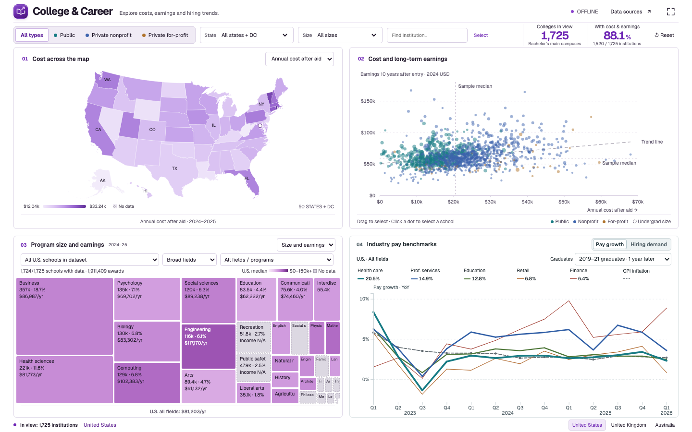

# College & Career

**[Open the interactive dashboard](https://xingsuli.github.io/college-and-career/)**

Explore U.S. colleges, majors, graduate outcomes and hiring trends in four linked D3 views.
Designed for desktop: a fixed 2 × 2 layout with no scrolling.



## Explore

1. **Map:** compare state-level college metrics; click to filter.
2. **Cost and earnings:** compare net price with earnings ten years after college entry; brush or select a school.
3. **Programs:** explore degree-award shares and published program income; select a major to link the market view.
4. **Market:** switch between industry pay growth with a CPI reference and recent hiring demand.

The Graduates menu keeps three representative groups: 2019–21 graduates one year later,
2016–18 graduates five years later, and 2010–12 graduates ten years later.

## Data snapshot

- 1,725 institutions; 1,724 have program awards data.
- Program composition: IPEDS 2024–25 bachelor's awards.
- Program income and employment destinations: Census PSEO, 2026 Q2 release.
- Pay growth and CPI comparison: 2023 Q1–2026 Q1. The missing CPI quarter is connected without adding an observation.
- Hiring demand: Indeed indices through October 23, 2026.

## Countries

Use the selector at the bottom right. All three views use a clickable map,
linked scatterplot, program treemap, and market line chart with Pay growth and
Hiring demand. Great Britain provider data come from DfE LEO, tax year 2023–24.
Australian outcomes use the pooled 2023–25 domestic undergraduate QILT
ComparED survey. UK and Australian scatterplots compare employment and
earnings, using the published local measures. UK industry shares are national
field benchmarks. Australia’s national industry curves use ABS WPI, with
survey response counts as the treemap area.

Map values are medians of published institution medians. UK boundaries use
ONS ITL1 (contains Ordnance Survey data © Crown copyright and database right
2025). Australian boundaries are from ABS ASGS Edition 4. UK wage growth uses
ONS EARN03. Both market charts stop at their last common wage and CPI quarter.
Job postings use Indeed Hiring Lab national and regional indices (CC BY 4.0).

See the [graduate outcome sources](provenance/international-sources.json) and
[map and market sources](provenance/country-map-market.json) for input hashes.
The scripts in tools/ prepare the bundled data from the listed extracts.

## Run and edit

The published files are in **`docs/`**. Open `docs/index.html` locally or serve it:

```sh
python3 -m http.server 8000 --directory docs
```

No framework, package installation, build step, backend or API key is required.
D3 is bundled in `docs/vendor/`. The chart modules are `app.js`, `school-programs.js`,
`industry-pay.js` and `hiring.js`; `colors.js` holds the shared palette.
Read [CODE_GUIDE.md](CODE_GUIDE.md) for the selection model and calculations.

GitHub Pages publishes the `docs/` folder. Commit and push changes to update the website.

## Sources and credits

- [College Scorecard](https://collegescorecard.ed.gov/data/)
- [IPEDS](https://nces.ed.gov/ipeds/use-the-data/download-access-database)
- [ACS 2025 field earnings benchmarks](https://data.census.gov/table/ACSDT1Y2025.B15013)
- [Census PSEO](https://lehd.ces.census.gov/data/pseo_documentation.html)
- [BLS QCEW](https://www.bls.gov/cew/), [CPI](https://www.bls.gov/cpi/), and [May 2025 OEWS industry wage medians](https://www.bls.gov/oes/2025/may/oessrci.htm)
- [Indeed Hiring Lab Job Postings Tracker](https://github.com/hiring-lab/job_postings_tracker), CC BY 4.0; snapshot transformed to weekly observations.
- D3 and map geometry: licenses retained in `docs/vendor/`.

Source periods and hashes are in `docs/source-manifest.js` and [provenance/](provenance/).


The header's **Data sources** button opens primary source links. The
graduate-destination KPI, page footer and lower market-chart notes are removed.
Quarter ticks and years remain visible in the fixed four-panel layout.


The displayed cost label is **Annual cost after aid** (the underlying Scorecard
net-price field). It averages total yearly attendance costs, including tuition
and living expenses, minus grants and scholarships.


Typography uses self-hosted [Geist Sans](https://vercel.com/font), distributed
under SIL OFL 1.1; the font license is included beside the bundled font.
Cards use 6px corners and thin borders; controls share a 4px corner system.
The offline single-file export embeds the font and requires no font CDN.
